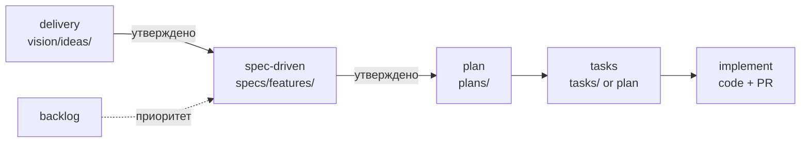

---
tags:
  - tvoy-hod/layer/system
aliases:
  - DOCUMENTATION_SYSTEM
---
# Система документации монорепозитория

Как хранить знания о продукте и превращать их в **спеки → планы → задачи → разработку**.  
Скиллы: **delivery** (идеи), **delivery** (спеки), **delivery** (задачи).

---

## Владение документами

Входы раздельные: [Game](game/README.md), [Plan](plan/README.md).
Материалы игры находятся в `docs/game/`, материалы Plan — в `docs/plan/`.
Внутри продукта сохраняются слои foundation/specs/vision/plans/tasks и остальные
предметные разделы. Общие decisions/ai/templates, правила репозитория и
shared-kernel план остаются вне продуктов. Не дублировать spec между ветками.
Прежние адреса Game — ссылки совместимости, исключённые из обычного поиска;
канонические адреса и исходные SHA-256 — в [реестре](product-doc-relocations.json).

## 1. Текущая структура (по продуктам, с 08.11.2026)

Рабочая карта каталогов и правила исключения истории из поиска:
[PROJECT_STRUCTURE](PROJECT_STRUCTURE.md). Архив хранится в Git, но не входит
в обычный поиск; старые адреса сохраняются как короткие ссылки.

| Слой | Папка |
|------|--------|
| **Handbook** | `docs/game/handbook/` — GDD и пакет для людей (скилл **delivery**) |
| Foundation | `docs/game/foundation/` |
| Vision | `docs/game/vision/ideas/` |
| Specs | `docs/game/specs/`, `docs/game/specs/features/` |
| Plans / Tasks | `docs/game/plans/`, `docs/game/tasks/` |
| Backlog | `docs/game/backlog/` |
| Marketing | `docs/game/marketing/` — посты, трекер, стратегия (вне dev-цикла) |
| **Audits** | `docs/audits/` — снимки (продукт, engineering, QA, UX, liveops); инструкция [`audits/README.md`](audits/README.md) |
| Reference | `docs/game/reference/` |

Карта: [`README.md`](README.md). Трассировка: [`TRACEABILITY.md`](TRACEABILITY.md).

**Направления (с 2026-10-27).** Таблица выше — слои документов **игры** внутри `docs/game/`. Продукт **Plan** ([ADR-016](decisions/ADR-016-two-products-shared-fincore.md)) живёт в [`plan/`](plan/README.md) с теми же слоями внутри (`vision/`, `specs/`, `plans/`) и своим `ROADMAP.md`. Ядро (`fincore`, `platform`) — ADR в `decisions/` и [`plans/PLAN_game-plan-split.md`](plans/PLAN_game-plan-split.md). Карта роадмапов — [`ROADMAPS.md`](ROADMAPS.md). Порядок канона C-1 действует внутри направления: для Plan spec — `plan/specs/SPEC_*.md`.

**Остаётся улучшать:** сверка оглавления `SPEC_PRODUCT` (раздел 0) и «Часть II» в evolution-документе через ссылки, не дублирование; нарезка MQ-* для G1; ADR по миграции `mode`.

---

## 2. Варианты структуры

**Навигация по задачам владельца (07.11.2026):**
[ТВОЙ ХОД](game/tasks/README.md) в `docs/game/tasks/`,
[ТВОЙ ПЛАН](plan/tasks/README.md) в `docs/plan/tasks/`.
Здесь собраны карточки и страницы очереди со ссылками на существующие spec/
планы; это не перенос канона и не новый уровень приоритета выше code/spec.
Инженерные чеклисты — `docs/game/tasks/ENGINEERING.md`; очередь владельца — рядом.

### Вариант A — по слоям зрелости (рекомендуемый)

Документ «поднимается» по цепочке: идея → спека → план → код.

```text
docs/
  README.md                      # выбрать продукт
  game/                          # канон ТВОЙ ХОД
    README.md
    foundation/
    handbook/
    specs/features/
    vision/ideas/
    plans/
    tasks/
    backlog/
    ux/
    events/
    audits/
    ops/
    marketing/
    reference/
    balance/
  plan/                          # канон ТВОЙ ПЛАН
    README.md
    vision/
    specs/
    plans/
    tasks/
    research/
    audits/
  decisions/                     # ADR репозитория и продуктов
  ai/                            # общий процесс разработки
  templates/                     # общие шаблоны
  conventions/                   # журнал разбора решений
  plans/                         # shared kernel и инфраструктура
  audits/ai/                     # общий AI-контур
  archive/                       # история вне обычного поиска
```


**Плюсы:** прозрачный pipeline, агенту понятно «на какой фазе документ».  
**Минусы:** нужна одноразовая раскладка существующих файлов.

---

### Вариант B — по доменам (экономика / UI / API / meta)

```text
docs/domains/economy/   docs/domains/ui/   docs/domains/api/
```

**Плюсы:** удобно команде «владельцам» домена.  
**Минусы:** одна фича режет несколько папок; сложнее idea → spec → tasks.

**Когда брать:** если команда >3 человек и стабильные владельцы доменов.

---

### Вариант C — минимальный (оставить как есть + шаблоны)

Только добавить `docs/templates/` и правила ссылок; не переносить файлы.

**Плюсы:** дёшево.  
**Минусы:** дублирование и путаница останутся.

---

## 3. Миграция (выполнено)

| Было | Стало |
|------|--------|
| `docs/SPEC_PRODUCT.md` | `docs/game/foundation/SPEC_PRODUCT.md` |
| `docs/ideas/*.md` | `docs/game/vision/ideas/` |
| `docs/PRODUCT_BACKLOG.md` | `docs/game/backlog/PRODUCT_BACKLOG.md` |
| `docs/ANALYTICS_CONCEPT.md` | `docs/game/specs/SPEC_ANALYTICS.md` |

Редиректы в корне `docs/` и папка `docs/ideas/` удалены 2026-05-26 — только канонические пути.
| `docs/brandbook/`, `investor-deck/`, GDD | `docs/game/reference/` |
| Эпик Game/Plan | `specs/features/SPEC_game-plan.md` + `plans/PLAN_game-plan.md` |

`AGENTS.md` — индекс в корне репозитория.

**Правило единого источника истины (при конфликте) — [C-1](../CONVENTIONS.md):**

1. **Поведение в production** — код + тесты  
2. **Спека фичи** — `docs/game/specs/features/SPEC_*.md`
3. **Foundation** — `docs/game/foundation/SPEC_PRODUCT.md`
4. **Vision / ideas** — направление, не детали реализации  
5. **Бэклог** — приоритет, не спецификация  
6. **Audits** (`docs/audits/`) — снимок на дату; **не** подменяет п.1–4, пока выводы не утверждены в spec/ADR/backlog. Инструкция: [`audits/README.md`](audits/README.md).

---

## 4. Конвейер: от идеи до кода



### Фаза 0 — Идея (`delivery`)

**Вход:** сырая гипотеза, обсуждение.  
**Выход:** `docs/game/vision/ideas/<slug>.md` (one-pager):

- Problem Statement (How Might We)
- Recommended Direction
- Key Assumptions + как проверить
- MVP Scope / Not Doing
- Open Questions

**Гейт:** человек подтвердил направление → можно писать spec.  
**Не делать:** код и детальные API до гейта.

---

### Фаза 1 — Спека (`delivery`)

**Вход:** утверждённая идея + `foundation/SPEC_PRODUCT.md` + затронутые доменные spec.  
**Выход:** `docs/game/specs/features/SPEC_<slug>.md` (шаблон — `templates/SPEC_FEATURE.md`).

Обязательные блоки spec:

| Блок | Назначение |
|------|------------|
| Objective | зачем, для кого, success criteria |
| Scope In / Out | границы фичи |
| User flows | ссылки на `TMA_USER_FLOWS` или новые шаги |
| Data & API | поля, эндпоинты, изменения моделей |
| UI | ссылки на `SPEC_FRONTEND_UI` / экраны |
| Rules & edge cases | экономика, период, ошибки |
| Testing strategy | что доказать тестами |
| Boundaries | Always / Ask first / Never |
| Open questions | до старта кода |

**Гейт — Definition of Ready (DoR) для spec:**

- [ ] Success criteria измеримы (не «сделать лучше»)
- [ ] Out of scope явно перечислен
- [ ] API/UI поля названы или помечены TBD с владельцем
- [ ] Зависимости от других spec указаны
- [ ] Assumptions вынесены в начало файла

---

### Фаза 2 — План (`spec-driven` + planning skill)

**Вход:** утверждённая spec.  
**Выход:** `docs/<game|plan>/plans/PLAN_<slug>.md`:

- dependency graph (БД → API → frontend)
- вертикальные срезы (не «весь backend, потом весь frontend»)
- риски и откат
- checkpoints для review

---

### Фаза 3 — Задачи (`delivery`)

**Вход:** plan.  
**Выход:** секция **Tasks** в том же `PLAN_*.md` или `docs/game/tasks/TASKS_<slug>.md`.

Шаблоны: [`templates/PLAN_FEATURE.md`](templates/PLAN_FEATURE.md), [`templates/TASK_SLICE.md`](templates/TASK_SLICE.md).

Формат задачи (копировать в plan / `docs/game/tasks/`):

```markdown
### MQ-042 — Краткое название
- **Phase:** build
- **Skill:** delivery
- **Next skill:** verify-change
- **Spec:** specs/features/SPEC_save-kind.md §3.2
- **Acceptance:** …
- **Verify:** `pytest …` / ручной сценарий / `npm run build`
- **Files:** backend/…, frontend-react/…
- **Estimate:** S | M | L
- **Depends:** MQ-041
```

`phase`: `define` | `build` | `verify` | `ship` — маршруты Codex: [`ai/CODEX-PROCESSES.md`](ai/CODEX-PROCESSES.md).

После нарезки задач обновить строку эпика в [`TRACEABILITY.md`](TRACEABILITY.md) (колонки Plan / Backlog / Статус).

#### Карточки задач в Trello: готовый промпт

Каждая создаваемая или обновляемая карточка задачи в Trello должна содержать
в описании отдельный блок **«Промпт для начала чата»** с готовым текстом для
копирования целиком. Одного короткого поручения или ссылки на материалы недостаточно.

Промпт соответствует следующему действию по карточке:

- **Выполнение:** что нужно сделать, в каком продукте и репозитории, какие
  исходные документы прочитать, границы работы, ожидаемый результат и критерии проверки.
- **Обсуждение результатов:** что уже выполнено, где лежат результат и проверки,
  что нужно разобрать с владельцем и какое решение требуется. Не формулировать
  такой промпт как повторное выполнение уже сделанной работы.

Если карточка включает оба этапа, добавить два явно подписанных промпта.
Текст должен позволять начать новый чат без восстановления контекста из прошлого:
указывать ID задачи, конкретные пути или ссылки и известные зависимости.
Неизвестные результаты не придумывать; перед передачей на обсуждение обновить
промпт по фактическому выполнению. Промпт не заменяет spec, не снимает зависимости
и не является человеческим approval.

Правило общее для ТВОЕГО ХОДА и ТВОЕГО ПЛАНА. При взятии существующей карточки
без промпта сначала дополнить её описание по этому правилу.

**Связь с бэклогом:** в `PRODUCT_BACKLOG.md` каждый пункт:

`- [ ] P1 Заголовок — см. SPEC_<feature> (путь к spec выбранного продукта), задачи MQ-040–MQ-045`

---

### Фаза 4 — Реализация

- Код по `delivery` + `verify-change`
- PR description: `Spec: docs/game/specs/features/…` + список MQ-*
- После merge: обновить spec (статус `implemented`), отметить `[x]` в backlog

---

## 5. Механизмы полноты и актуальности

### 5.1. Статус в frontmatter (в начале каждого spec/plan)

```yaml
---
status: draft | review | approved | implemented | stale
owner: имя или роль
last_reviewed: 2026-05-16
tracks: save-kind, game-plan
tags:
  - tvoy-hod/layer/spec
aliases:
  - SPEC_example
---
```

Поля **`tags`** и **`aliases`** для Obsidian генерирует `node scripts/docs/obsidian-enrich.mjs` (не править вручную, кроме редких псевдонимов). Гайд vault: [`OBSIDIAN.md`](OBSIDIAN.md).

### 5.2. Матрица трассировки (одна таблица в backlog или отдельный файл)

| ID | Idea | Spec | Plan | Backlog | Статус |
|----|------|------|------|---------|--------|
| G1 | evolution §II | SPEC_save-kind (draft) | — | P0 save_kind | in progress |

### 5.3. Чеклист «документация готова к разработке»

Перед стартом эпика:

- [ ] Foundation актуален для этой области
- [ ] Idea утверждена или помечена «spec без idea» (мелкий фикс)
- [ ] Feature spec в статусе `approved`
- [ ] Plan с вертикальными срезами
- [ ] Задачи с acceptance + verify
- [ ] Open questions пусты или перенесены в backlog P2
- [ ] `AGENTS.md` / Codex skills не противоречат spec

### 5.4. Ритуалы (лёгкие)

| Когда | Действие |
|-------|----------|
| Новая крупная идея | delivery → `vision/ideas/` |
| Старт спринта | выбрать spec `approved`, выгрузить tasks |
| Конец фичи | spec → `implemented`, backlog `[x]`, при необходимости ADR |
| Раз в 1–2 месяца | пройти foundation + устаревшие `stale` |

### 5.5. ADR для решений «почему»

Когда выбор необратим или спорный (Alembic vs SQL, save_kind schema):

`docs/decisions/ADR-001-save-kind-migration.md` — контекст, решение, последствия.

Spec отвечает на **что**; ADR на **почему так**.

### 5.6. Агент и разработчик

| Роль | Читает первым |
|------|----------------|
| Агент (любая задача) | `AGENTS.md` → `docs/README.md` → spec фичи |
| UI | + `specs/SPEC_FRONTEND_UI.md` |
| Продукт | `foundation/SPEC_PRODUCT.md` + `vision/ideas/` |

---

## 6. Шаблоны (создать в `docs/templates/`)

| Файл | Назначение |
|------|------------|
| `IDEA_ONEPAGER.md` | выход delivery |
| `SPEC_FEATURE.md` | фича целиком |
| `PLAN_FEATURE.md` | план (`epic_id`, `next_skill`, срезы) |
| `TASK_SLICE.md` | одна MQ-* (`phase`, `tier`, `skill`, `satellites`, `next_skill`) |
| `ADR.md` | архитектурное решение |
| `TRACE_ROW.md` | строка матрицы трассировки |

Команда: `$delivery` + стадия `idea`, `spec` или `plan` → соответствующий шаблон. Проверка — `$verify-change`, review — `$review-change`.

---

## 7. Следующие шаги

1. Утвердить [`SPEC_game-plan`](game/specs/features/SPEC_game-plan.md) и нарезать MQ-* в [`PLAN_game-plan`](game/plans/PLAN_game-plan.md).
2. В backlog для P0 Game/Plan — ссылки на spec + MQ-id.
3. При спорной миграции `mode` — [`decisions/ADR-001`](decisions/) (создать).
4. Новые идеи — только в `vision/ideas/` (шаблон [`templates/IDEA_ONEPAGER.md`](templates/IDEA_ONEPAGER.md)).

---

## 8. Быстрые команды для агента

```text
Идея:      «delivery: …» → docs/game/vision/ideas/<slug>.md
Спека:     «spec: …» → docs/game/specs/features/SPEC_<slug>.md (DoR checklist)
План:      «plan для SPEC_<slug>» → docs/<game|plan>/plans/PLAN_<slug>.md
Задачи:    «разбей PLAN на задачи MQ-*» → секция Tasks
Бэклог:    «добавь в backlog P1 со ссылкой на spec»
```

---

## 9. Obsidian

Репозиторий — **Obsidian vault** (корень `telegram-mini-app/`). Markdown-ссылки сохраняются для GitHub и агентов; навигация в Obsidian — через `tags`, `aliases`, MOC (`docs/*/_index.md`) и [`Home.md`](Home.md).

После правок frontmatter: `node scripts/docs/obsidian-enrich.mjs`.

---

*Живой документ. При смене структуры обновляйте `docs/README.md` и этот файл.*
