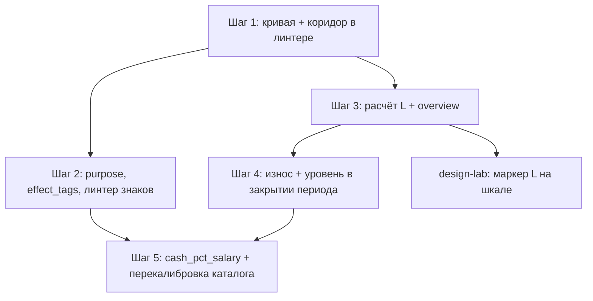

# План NV: износ потребностей, уровень жизни и цена балла

Нарезка под [SPEC_needs-set-point](../specs/features/SPEC_needs-set-point.md). Пять шагов из [idea](../vision/ideas/needs-value-curve.md); каждый — отдельный PR с зелёными проверками.

## 1. Граф зависимостей

Шаги 1 и 3 независимы и могут идти параллельно (разные файлы). Шаг 5 — последним: числа каталога калибруются под уже работающую модель.

## 2. Шаги и задачи

### Шаг 1 — Кривая цены и коридор (только отчёт)

Primary: **game-economy-and-victory** · satellite: test-driven-development

| ID | Задача | Файлы | DoD |
|----|--------|-------|-----|
| NV-101 | `needs_points(cost, salary, *, k=25, alpha=0.3)` | `backend/app/needs/value_curve.py` (новый) | CS-7 зелёный |
| NV-102 | Коридор ±50% для выборов с `needs+` и ценой; warnings, не errors | `backend/app/events/balance_contract.py`, `scripts/event_catalog_report.py` | отчёт со списком выбросов; baseline violations = 0 не меняется |
| NV-103 | MCE §12: месячный платёж за горизонт, ссылка на кривую | `.claude/skills/create-event/event-balance-rules.md` §6, §12 | правила согласованы с кодом |

Проверка: `cd backend && py -3 -m pytest -q`.

### Шаг 2 — Назначение траты и механизмы

Primary: **create-event** · satellites: event-analysis, test-driven-development

| ID | Задача | Файлы | DoD |
|----|--------|-------|-----|
| NV-201 | Справочник механизмов `tag → plus/minus` | `data/events/mvp11/meta/needs_effect_map.yaml` | ≥ 9 механизмов из idea |
| NV-202 | Загрузка `purpose`, `effect_tags` в catalog/contract | `backend/app/events/mvp11_catalog.py`, `mvp11_contract.py` | неизвестный tag/purpose → ошибка |
| NV-203 | Линтер знаков: ось с плюсом без механизма → нарушение; коридор кривой только для `pleasure` | `balance_contract.py` | CS-8 |
| NV-204 | Разметка 174 выборов mvp11 | `data/events/mvp11/*.yaml`, `chains/` | 0 нарушений; спорные выборы — в отчёт PO |
| NV-205 | Проверка `event_domain` против `VALID_EVENT_DOMAINS` (4 битых ключа из аудита) | `taxonomy.py`, YAML | contract ловит неизвестный домен |
| NV-206 | §11 правил → ссылка на справочник механизмов | `event-balance-rules.md` | |

Проверка: `py -3 -m pytest -q -k "mvp11 or balance"`, `/event-analysis`.

### Шаг 3 — Уровень жизни L (только чтение)

Primary: **game-economy-and-victory** · satellites: api-and-interface-design, test-driven-development

| ID | Задача | Файлы | DoD |
|----|--------|-------|-----|
| NV-301 | Парсинг `needs.model` и `needs.set_point` с дефолтами spec | `backend/app/needs/engine.py` (`parse_needs_config`) | старые конфиги без изменений |
| NV-302 | `derive_wear(cfg)` из `passive_periods_to_zero`; `bonus_cap` по оси; проверка инварианта давления | `backend/app/needs/set_point.py` (новый) | CS-5 на всех сидах |
| NV-303 | `compute_level(db, profile, cfg) → LevelResult(level, sources)`: бюджет относительно нормы, привыкание, активы, стрессоры, потолок | `backend/app/needs/set_point.py` | CS-2, CS-3 (unit на чистых входах) |
| NV-304 | Период покупки актива для привыкания: поля нет → миграция `acquired_period_index` (**ask first**, ждёт решения PO). Пока возраст — от начала игры | `models.py`, `backend/migrations/`, места создания `FinanceAsset` | возраст актива доступен |
| NV-305 | Overview: `needs_meta.model`, `level`, `wear`, `level_sources`, `periods_to_zero_if_idle` | `backend/app/finance/overview_build.py`, `schemas.py` | CS-9 |
| NV-306 | FE-зеркало: чтение полей без UI | `frontend-react/src/api/finance.js` | `npm run build`, `test:unit` |
| NV-307 | README карты API | `backend/app/README.md` | |

Проверка: pytest; `economy-reviewer` по диффу.

### Шаг 4 — Износ + уровень жизни в закрытии периода

Primary: **game-economy-and-victory** · satellites: critical-test-scenarios, doubt-driven-development, balance-playtest

| ID | Задача | Файлы | DoD |
|----|--------|-------|-----|
| NV-401 | `apply_wear_and_level(cfg, before, level, wear) → NeedsDecayResult`: `N + r(L − N) − w`, порог нуля | `backend/app/needs/engine.py` | unit |
| NV-402 | Ветка в `_apply_needs_decay` по `needs.model`; порядок шагов закрытия по spec | `backend/app/game/period.py` | CS-1, CS-3, CS-4; CS-6 (linear не изменился) |
| NV-403 | Всплески: множитель «запас до 100» в `choose` и treat-self только при `set_point` | `services/events/choose.py`, `services/period/treat_self.py` | unit |
| NV-404 | Ответ `time/next`: `model`, `level`, `wear`, `after` | `game/period.py`, `schemas.py`, `src/api/game.js` | контракт |
| NV-405 | Бот-стратегии: пассивный, аскет, пассивный с просрочкой, активный 2 × 2/4/7% зарплаты, активный + подписки/авто (перенос скрипта симуляции из spec §5, с `bonus_cap`) | `backend/scripts/balance_playtest.py` | сценарии в отчёте |
| NV-406 | Перевод Студента на `set_point`, прогон 30–40 периодов, калибровка K_imp / T / r / K_L / стрессоров | seeds, `docs/balance/reports/` | пассивный → поражение на T ± 2; аскет и долг — раньше; активный 2 × 4% жив 40 периодов с уровнем 35–50 (CS-10) |
| NV-407 | Перевод остальных трёх шаблонов | seeds | balance diff без регрессий |
| NV-408 | Справка «Почему снижаются» | `backend/app/needs/guide_content.py` | рутина изнашивает, уровень жизни смягчает, события восполняют |
| NV-409 | ADR-015 → accepted, обновить SPEC_game-character-needs и ADR-005 (ссылка «§3 заменён ADR-015») | docs | |

Проверка: pytest, `/balance-playtest`, `economy-reviewer`, `/code-review`.

### Шаг 5 — Суммы в % зарплаты и перекалибровка каталога

Primary: **create-event** · satellites: event-analysis, balance-playtest

| ID | Задача | Файлы | DoD |
|----|--------|-------|-----|
| NV-501 | `cash_pct_salary` в effects: расчёт в choose и impacts | `services/events/choose.py`, `events/choice_impacts.py`, contract | unit + impacts в payload |
| NV-502 | Перевод soft_offer/universal выборов на `cash_pct_salary`; удаление дублей-скинов (`coffee_*`, `phone_*`), если покрываются % | YAML | персоны Руководитель/Предприниматель видят те же события |
| NV-503 | Перекалибровка `needs_delta` `pleasure`-выборов под кривую (потолок 10 на ось) | YAML | коридор: 0 warnings |
| NV-504 | `mitigation`-выборы: минус отказа > минуса оплаты, без плюсов | YAML | линтер |
| NV-505 | Лимиты повторов: `streaming_offer`, `lifestyle_creep` → `max_per_profile`; cooldown у `home_water_damage`, `car_accident` | YAML | аудит §10 чистый |
| NV-506 | Финальный `/balance-playtest` и baseline | `docs/balance/baselines/` | обновлённый baseline |

### Статус шага 4 (2026-10-15)

Сделано: NV-304 (миграция `0049`), NV-401–405. Модель включается флагом, сиды остаются `linear`.

**Калибровка NV-406 на реальном движке (Студент, 40 периодов, текущий каталог mvp11):**

| Конфигурация | `idle` (зарплата + самый дешёвый выбор) | `needs_keeper`: мин. / средн. потребность с 11-го периода |
|---|---|---|
| linear (как сейчас) | поражение needs на 11 | 35–64, без поражения |
| set_point, T 16 | поражение на 10 | 12 / 21 |
| set_point, T 20 | поражение на 11 | 16 / 24 |
| set_point, T 24 | поражение на 11 | 20 / 26 |
| set_point, T 20–24, r 0.15 | поражение на 10 | 11–12 / 18–19 |

Выводы:

- Пассивного игрока в реальном каталоге топят **штрафы отказа в событиях**, а не износ: поражение на 10–11 при любом T. Даже на модели linear — эталоны `docs/balance/baselines` (май) устарели, расхождение есть и на коммите до шага 4.
- Активный бот на set_point держится ниже цели 35–50 при любых T и r: ручки износа почти не помогают. Числа событий откалиброваны под линейный износ без «запаса до 100».
- **Блокер перевода шаблонов (ревью шага 4):** превью выбора (`events/payload.py` impacts) и опций «Порадовать себя» (`overview_build.py`) показывают сырой `needs_delta`, а при set_point применяется уменьшенный «запасом до 100». До NV-406 — показывать фактический прирост.
- **Решение:** не переводить шаблоны до шага 5. NV-406/407/408 переносятся после перекалибровки каталога (NV-503/504); NV-506 обновляет эталоны.

### Статус шага 5 (2026-10-21)

Сделано (код, без правки каталога): подсказки показывают фактический прирост при set_point (блокер NV-406 снят); `cash_pct_salary` (NV-501) и `purpose` (NV-202, только YAML + contract); коридор кривой только для `pleasure`; скрипт перекалибровки `backend/scripts/needs_recalibrate_catalog.py --k K` (93 правки, коридор 39 → 2 предупреждения, 0 нарушений Pareto); симулятор: бот `needs_keeper` с запасом на обязательные платежи, разбивка динамики «события / закрытие».

Перекалиброванный каталог закоммичен в `1a1c61f` (K 40, ось ≤ 15); воспроизводится `needs_recalibrate_catalog.py`.

Калибровка на 4 персонах (40 периодов, новая модель, перекалиброванный каталог):

| Настройка | Студент: `idle` / `needs_keeper` (мин. / средн.) | Профи, Руководитель: `needs_keeper` | Предприниматель |
|---|---|---|---|
| K 25, T 16, r 0.10 | поражение 13 / 5 / 14 | поражение needs 21–24 | поражение по деньгам на 5–7 |
| K 40, T 20, r 0.10 | 13 / 14 / 23 | поражение needs 24–25 | то же |
| K 40, T 30–40 | 14 / 18–19 / 26–27 | поражение needs 26–29 | то же |
| K 40, T 20, r 0.05 | 13 / 19 / 30 | поражение needs 24–25 | то же |

Выводы:

1. **Пассивный проигрывает на 8–14 при любых настройках** — давление работает, его в основном создают штрафы отказов.
2. **K, T и r почти не двигают активного игрока.** Правило давления даёт потерю ≈ r·N за период; прирост одного выбора ограничен потолком 10 на ось и двумя событиями.
3. **Профи и Руководитель проигрывают по потребностям из-за денег:** свободных денег 15–30 тыс., бот не может платить и выбирает отказы (события дают −4…−22 за период). `cash_pct_salary` удорожает события в 1,6–2,4 раза для этих персон, а свободных денег у них не больше, чем у Студента.
4. **Предприниматель проигрывает по деньгам к 5–7-му периоду** при любой модели — экономика шаблона, вне NV.

**Решение PO (2026-10-21) по (а): цена событий — доля зарплаты** («дорогие» события). Для Профи и Руководителя ограничение — не свободные деньги, а структура активов: игрок перераспределяет активы (продаёт лишнее, снижает расходы, направляет выручку в доходную часть) и за несколько шагов увеличивает денежный поток. Бот `needs_keeper` активы не перестраивает — нужен бот-реструктуризатор (NV-405b).

**Проверка тезиса PO (бот `restructure`: продаёт машины, гасит дорогие долги; T 20, r 0.05).** Каталог перекалиброван скриптом `--k K --axis-cap N`:

| Вариант | Студент `idle` | Студент `needs_keeper` (мин. / средн.) | Профи `restructure` (мин. / средн.) |
|---|---|---|---|
| K 25, потолок 10, 2 события | поражение 14 | 15 / 24 | 20 / 28 |
| K 25, 3 события | поражение 10 | 21 / 30 | 22 / 34 |
| K 40, потолок 15, 2 события | поражение 13 | 20 / 33 | 32 / 39 |
| **K 40, потолок 15, 3 события** | поражение 9 | **30 / 40** | **30 / 43** |

- Профи с перестройкой активов **выживает** (на T 20, r 0.05: 561 тыс. к 40-му периоду), без неё — проигрывает на 24: тезис PO подтверждён.
- Руководитель-реструктуризатор выживает только при мягком износе и с минимумом 0: бот продаёт обе машины, комфорт/статус проседают — бот слишком агрессивен, не экономика.
- Мягкие отказы (0.2–0.3) почти не влияют на активного; потолок 15 работает только вместе с K 40.
- Рекомендуемые параметры: K 40, потолок 15, T 20, r 0.05. Число событий за период (2 → 3) — правило игры, решение PO.

Остальные вопросы для PO: (б) источник роста активного игрока — больше событий за период / выше потолок оси / мягче отказы и обязательные события; (в) экономика Предпринимателя — отдельная задача.

### Перевод шаблонов (2026-10-21)

По решению PO все 4 шаблона переведены на `set_point` (NV-406/407), справка обновлена (NV-408), ADR-015 — accepted (NV-409), эталоны баланса обновлены (NV-506). **Приёмка выполнена не полностью — известные отклонения:**

| Критерий | Факт | Комментарий |
|---|---|---|
| Пассивный проигрывает на T ± 2 (18–22) | `idle` — на 13 | давление создают штрафы отказов в событиях, износ — вторичен; CS-1 (без событий) проходит |
| Активный держит 35–50 | Студент `needs_keeper`: средн. ~33–37, min к p40 = 22 | ниже порога distressed к концу; рост — через цепочки (решение PO: 2 события + цепочки поверх) |
| Без регрессий по 4 персонам | Руководитель `restructure` выживает с min 0; Предприниматель — поражение ~10 | бот продаёт обе машины (ограничение бота); экономика Предпринимателя — отдельная задача |
| Эталоны | 7 записей в manifest, включая Руководителя и Предпринимателя | `safety_first` проигрывал по деньгам на 3 и до изменений — бот сломан |

**Экономика Предпринимателя (решение PO 2026-10-22):** отрицательный поток на старте (≈ −6 000/пер.) оставлен как задача персонажа; подсказка о дыре в бюджете + A1 «Вторая машина» в первом периоде с событиями; стартовые потребности comfort 50 / status 55 / social 45 / health 25 (платит здоровьем). Нерегулярный доход — отдельная идея [`entrepreneur-irregular-income`](../vision/ideas/entrepreneur-irregular-income.md).

**2026-10-22:** цепочки freelance / used_car / family_vacation влиты (960c8db). Боты исправлены: `restructure` продаёт только лишние машины (при 2+ оставляет одну) и держит резерв на события; `safety_first` не переводит в подушку месячные платежи. Эталоны: Профи, Руководитель и Предприниматель с перестройкой активов **живут 40 периодов** (1,6 млн / 1,7 млн / 180 тыс.), активный Студент — min 31 к p40, пассивный — поражение на 15.

## 3. Контрольные точки

| После | Что показать PO |
|---|---|
| Шаг 2 | список спорных выборов из разметки (механизм не совпал с осями) |
| Шаг 3 | L, износ и «обнулится через N мес. без событий» для 4 персон (overview) |
| NV-406 | отчёт playtest Студента: период поражения пассивного/аскета/должника, уровень активного |
| Шаг 5 | diff баланса до/после, таблица ₽/балл по каталогу |

## 4. Риски

| Риск | Митигация |
|---|---|
| Активному игроку слишком тяжело (уровень < 30 при разумных тратах) | K_imp и T в NV-406; цель 35–50 |
| Пассивная игра без поражения из-за неверного конфига | инвариант давления в тесте на все сиды (CS-5) |
| Оси с низким стартом почти не «покупаются» уровнем жизни (`bonus_cap` 4 у social Предпринимателя) | проверить ощутимость в NV-406; при необходимости поднять base |
| Двойной учёт машины (актив + transport) | transport — расходы на езду, актив — владение; проверить в NV-406 |
| Каталог в смешанном состоянии между шагами 4 и 5 | шаг 4 переводит шаблоны только после NV-406; шаг 5 сразу следом |
