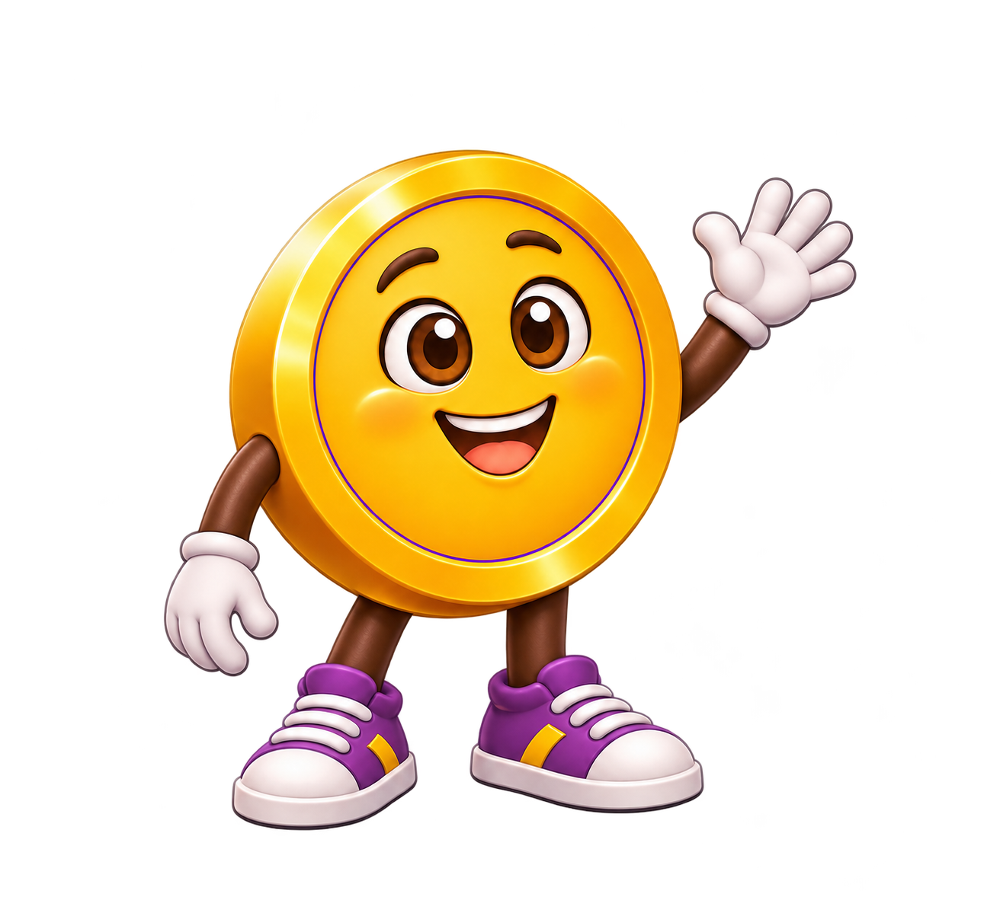
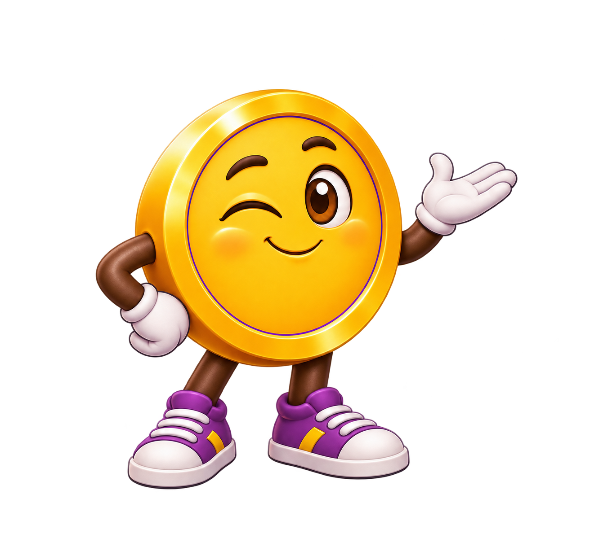
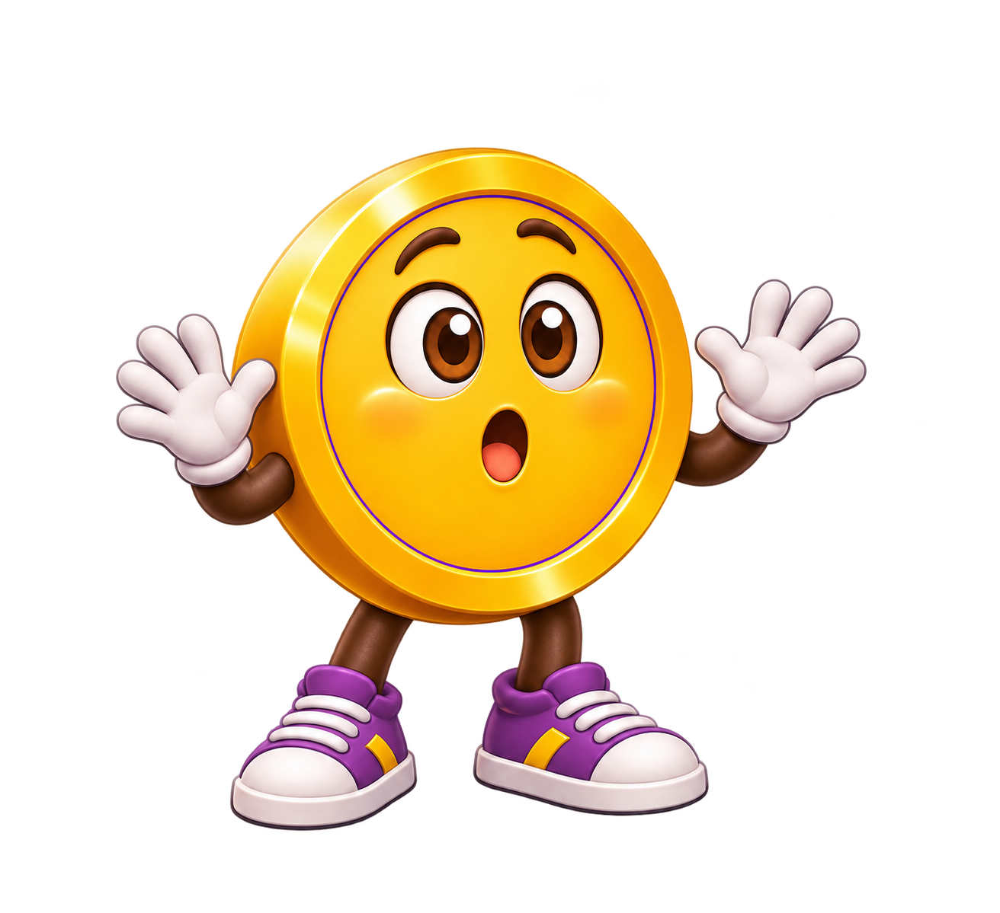
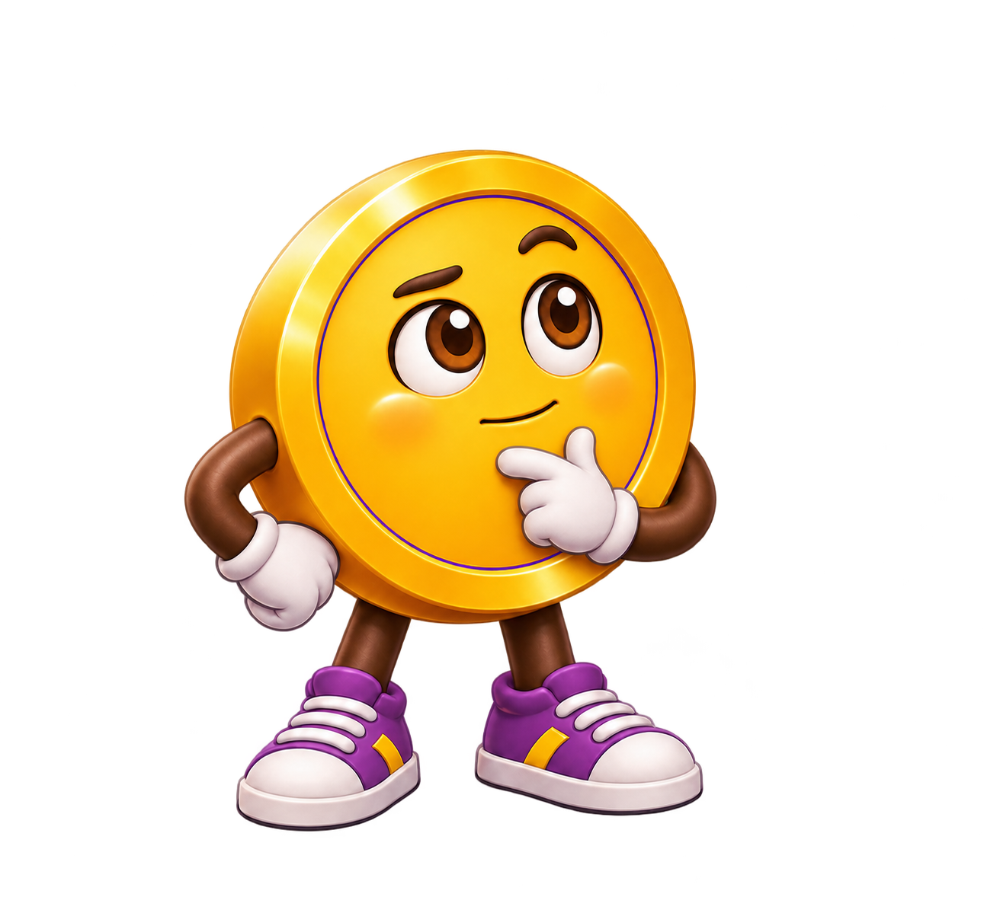
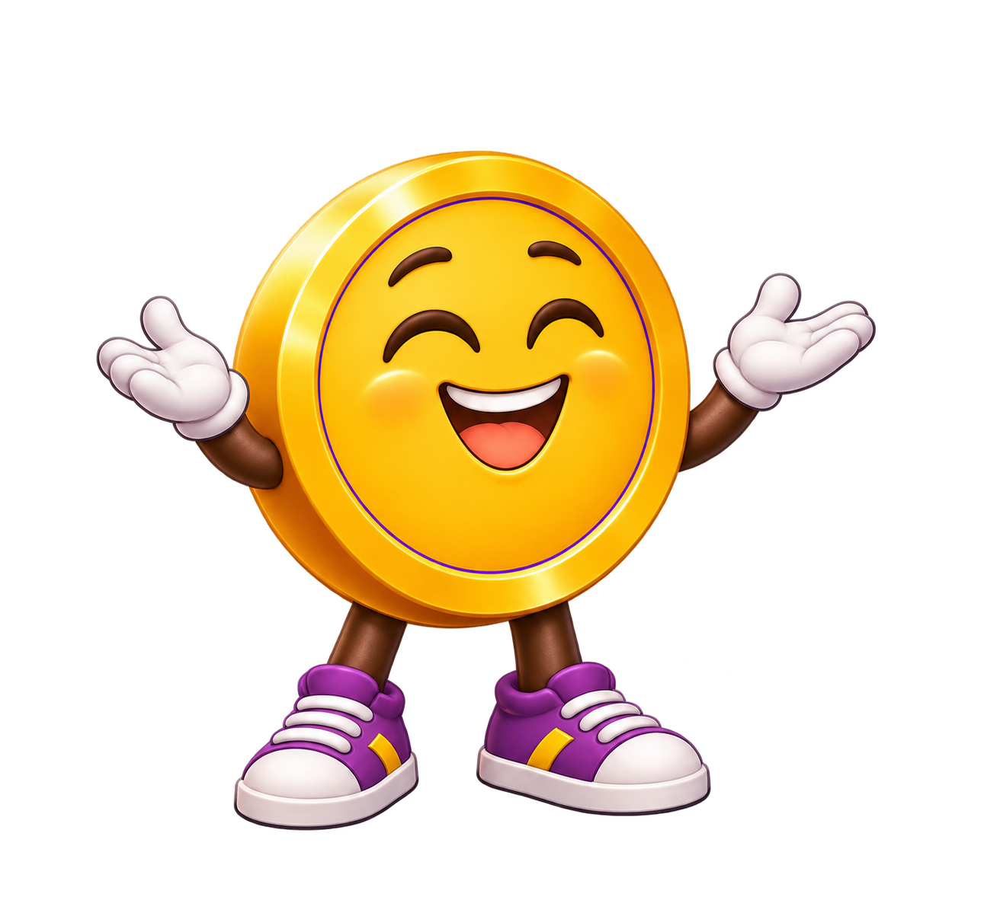
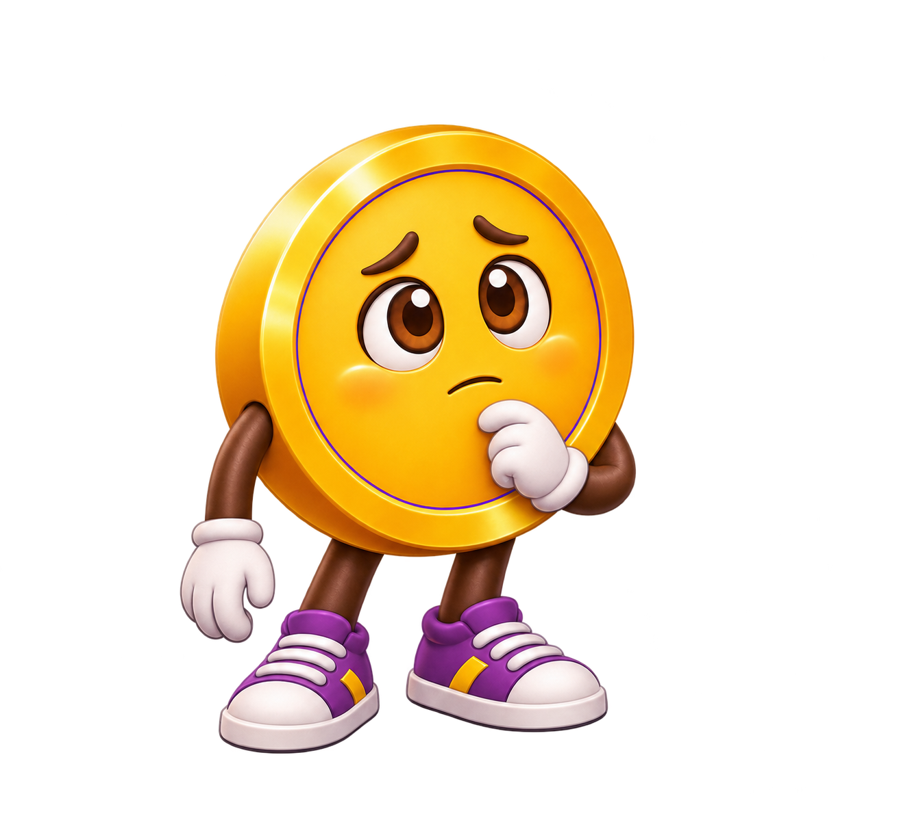
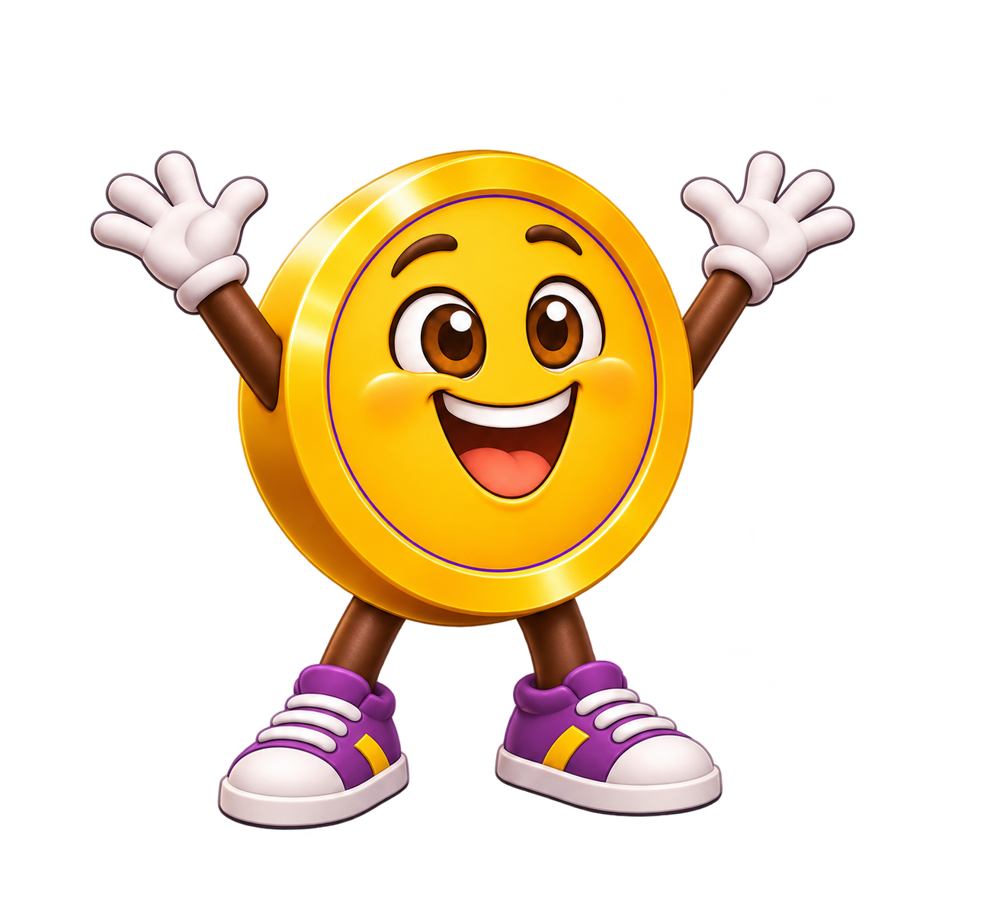
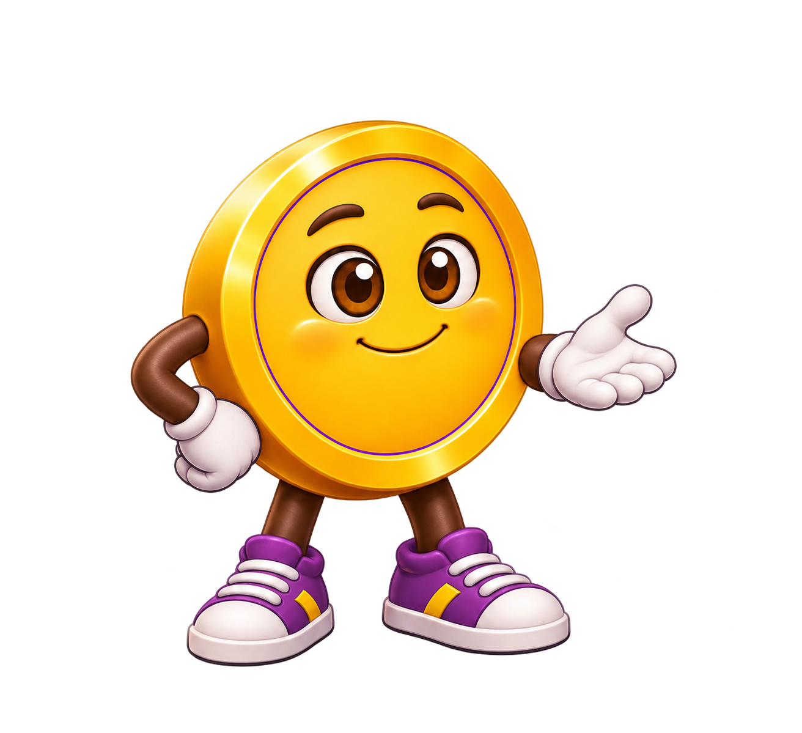
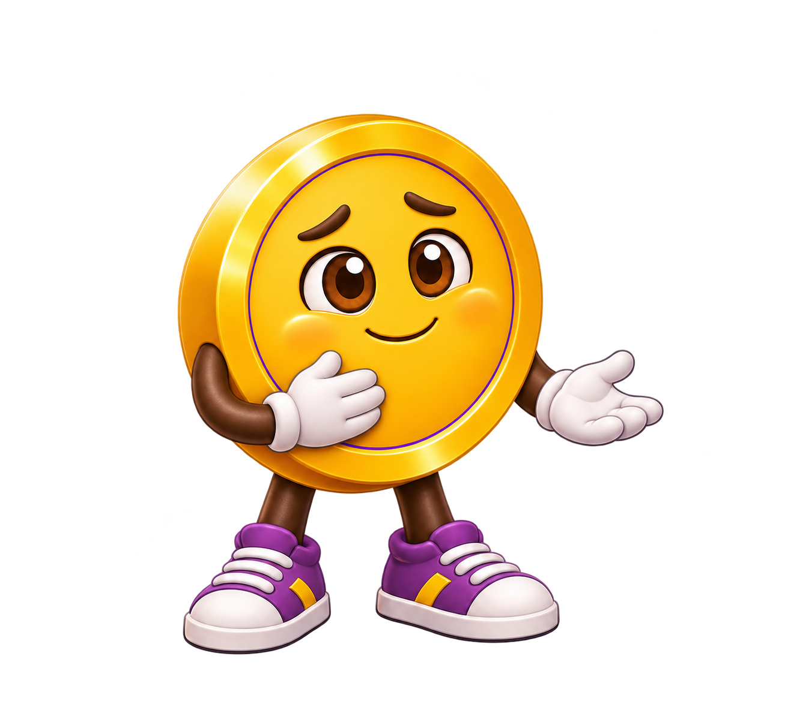

# Золотая Монетка · девять утверждённых поз и эмоций

Основа всех иллюстраций — [утверждённая золотая Монетка](../APPROVED.md). Сценарии взяты из [прежнего набора](../ink-mascots-round/README.md#ситуации-монетки). Приветствие используется и в день зарплаты, и в начале нового хода.

[Все девять поз рядом](overview.png)

| Ситуация | Поза и эмоция | Эскиз |
|---|---|---|
| День зарплаты, новый ход | Улыбка, приветственный взмах открытой ладонью |  |
| Зарплата ещё не получена | Подмигивание и поднятая ладонь |  |
| Новое событие | Удивление и раскрытые ладони |  |
| Объяснение механики | Задумчивый взгляд, рука у подбородка |  |
| Подушка растёт | Радость и раскрытые руки |  |
| Долг растёт | Сочувственная тревога, рука у подбородка |  |
| Победа | Широкая улыбка и обе руки вверху |  |
| Можно завершать ход | Спокойная улыбка и приглашающий жест |  |
| Неудачный ход | Сочувственная улыбка и открытая ладонь |  |

Все девять поз утверждены 19.11.2026. В игре «Победа» показывается в подсказке Главной по состоянию цели, «Поддержка» — в итогах хода с отрицательным балансом за ход, «Завершение хода» — в подсказке на Главной. PNG подготовлены с прозрачным фоном. Надписи к игровым ситуациям остаются текстом интерфейса.
