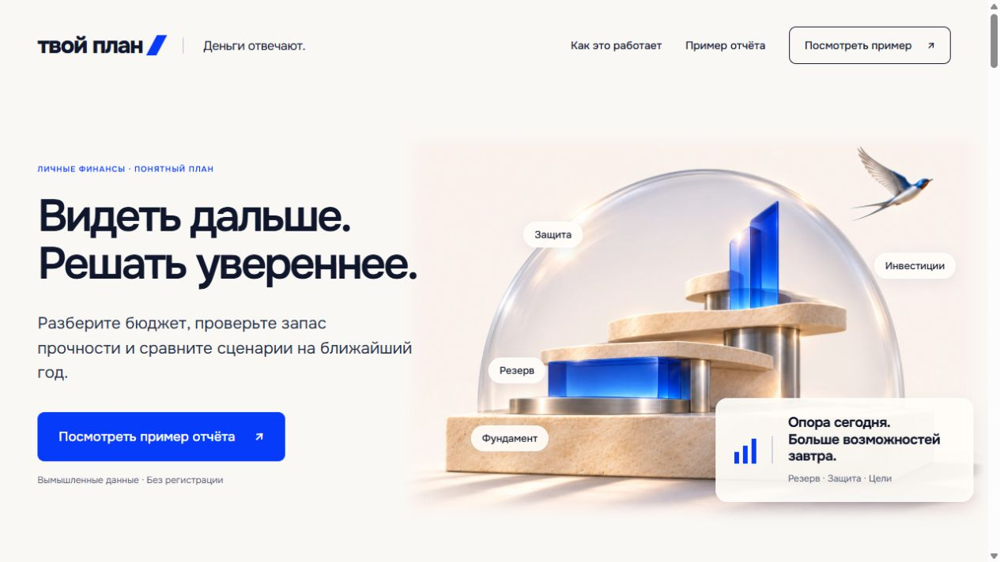
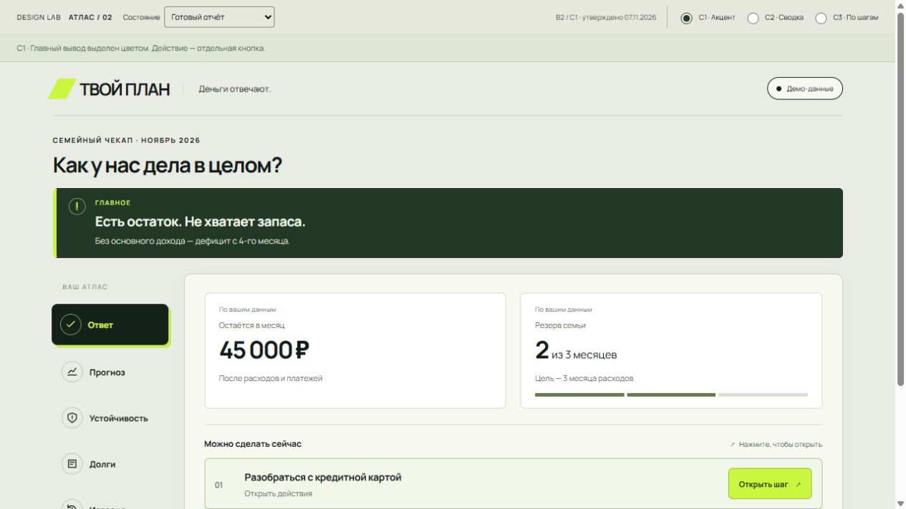
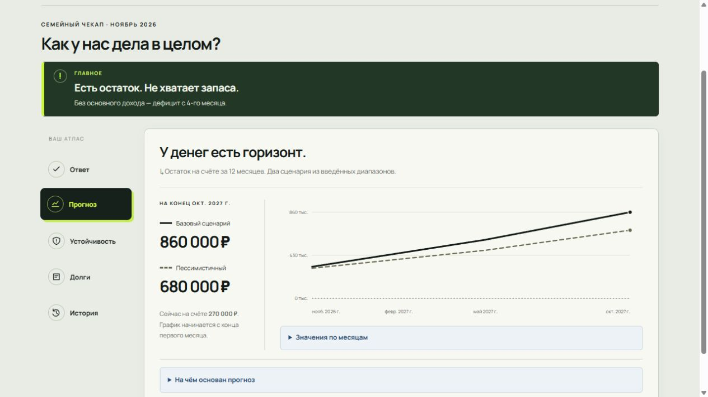
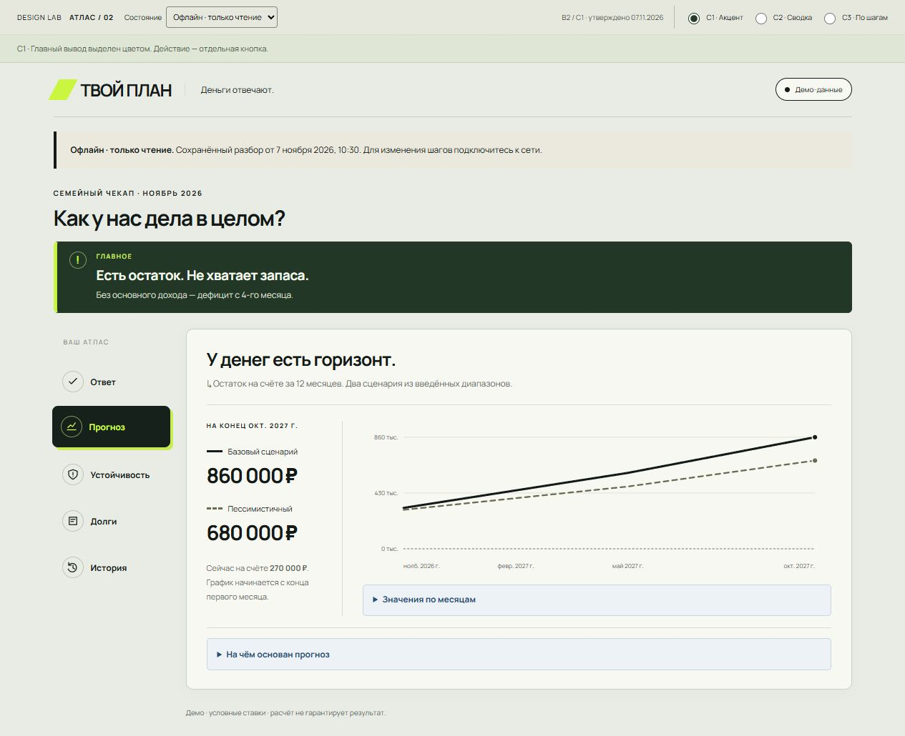
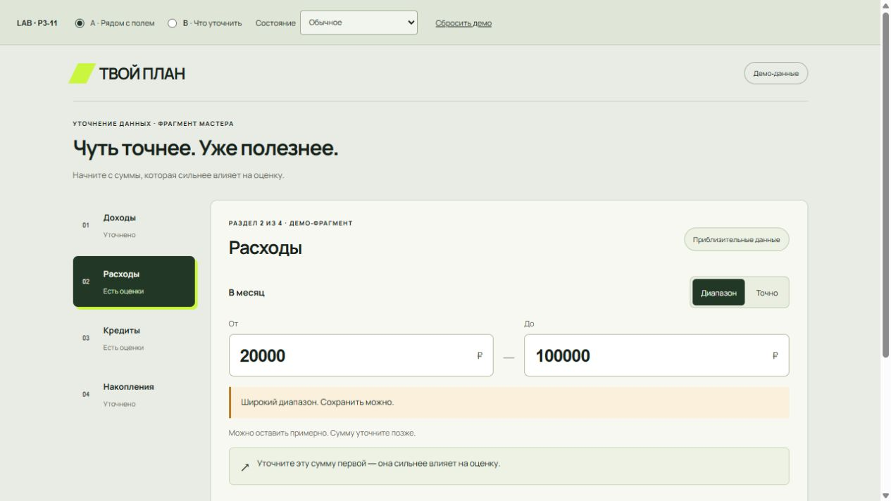
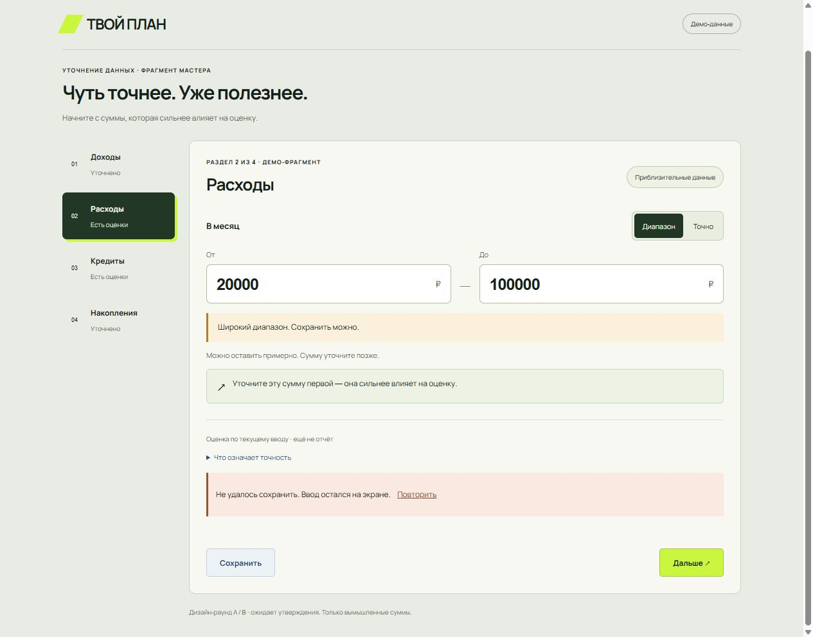
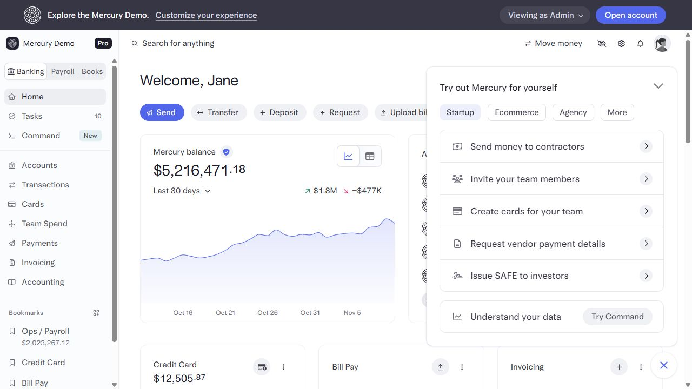
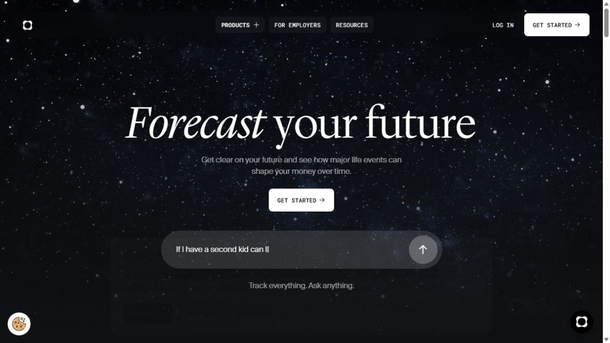
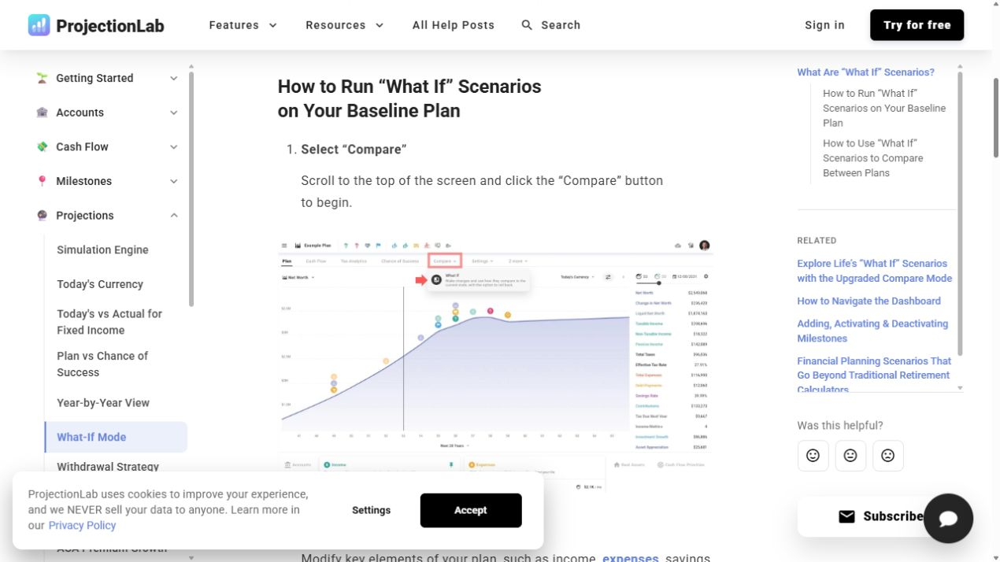
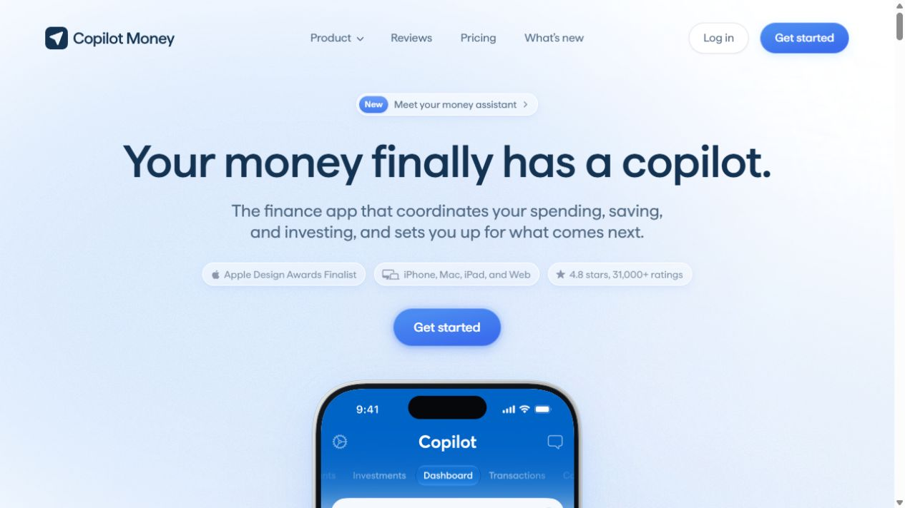

# ТВОЙ ПЛАН · калибровка дизайн-системы

Дата: 10.11.2026. Статус: исследование и предложение для следующего lab-раунда, не утверждённый новый канон. Автор: Codex. Продуктовые файлы, финансовые правила и опубликованный сайт этим исследованием не изменены.

## Вывод

Рекомендую сохранить архитектуру Финансового атласа и привести её к бренду опубликованного лендинга: тёплая светлая основа, тёмно-синий текст, один синий акцент, спокойные поверхности, понятная конструкция отчёта. Развивать систему вокруг последовательности «вопрос → вывод → основания → сценарий → действие → повторная проверка».

Ценность уже есть в продукте: диапазоны вместо ложной точности, объяснение расчётов, разделение черновика и итогового отчёта, сценарии и обратимые шаги. Основной долг — согласованность разных визуальных слоёв и повторяемый контракт компонентов.

## Область и метод

1. Проверен опубликованный [лендинг](https://avyakunichkin-code.github.io/tvoy-plan-landing/) в текущем запуске браузера.
2. Просмотрены существующие lab-экраны: атлас «Ответ», «Прогноз», офлайн-состояние; денежный ввод и ошибка сохранения. Это лаборатория с вымышленными данными, не сессия реального пользователя.
3. Сопоставлены исходники приложения: `styles.css`, `App.jsx`, `components.jsx`, `screens/atlas/`, `screens/precision/`, `history.css`, `StepActions.jsx` и общая библиотека `shared/packages/ui-kit`.
4. Изучены зарубежные продукты и первичные материалы. Mercury проверен в публичном интерактивном demo; Origin и Copilot — по публичным страницам и продуктовой документации; ProjectionLab — по официальному руководству с изображениями интерфейса; Monarch/Finary/Stripe — по документации. Это разные уровни свидетельств, не полный аудит всех приложений.
5. Скриншоты получены в этом исследовании. Старые изображения не использовались как свидетельства текущего состояния. Мобильный скриншот не принят: browser viewport override не дал ожидаемого размера для целевой вкладки. Мобильная доступность и reflow требуют отдельной проверки.

Принципы соответствуют [границам Plan](../../DESIGN.md): собственные визуальные токены; общий ui-kit — только общие примитивы поведения; без переноса MQX и экономики игры.

## Текущее состояние

### Три визуальных слоя

| Слой | Подтверждённый источник | Что видим | Значение для системы |
|---|---|---|---|
| Исходное Бенто | [styles.css](../../../web/src/styles.css) | Onest + Unbounded; цветные плитки; радиусы плиток 28 px, hero 34 px; светлая/тёмная тема | Базовые экраны и старые правила ещё влияют на приложение |
| Финансовый атлас | [atlas.css](../../../web/src/screens/atlas/atlas.css), [App.jsx](../../../web/src/App.jsx), [Report.jsx](../../../web/src/screens/Report.jsx) | Manrope, зелёные нейтрали, лайм, радиусы 6–8 px; редакционная иерархия, разделы отчёта | Это уже внедрённый слой: Report экспортирует AtlasReport; оболочка atlas-shell включается для report/refine |
| Опора и свобода | [опубликованный лендинг](https://avyakunichkin-code.github.io/tvoy-plan-landing/), `sites/tvoy-plan-landing/fintech.css` | Onest, молочный фон, тёмно-синий текст, cobalt CTA, камень/стекло, птица | Утверждённый внешний образ продукта, пока не общий контракт приложения |

Факт наличия трёх слоёв не делает каждый из них ошибкой. Проблема возникает на переходах: бренд, акцент действия, типографика и геометрия меняются вместе с экраном. Причина подтверждена кодом; весь переход авторизации → отчёта в runtime в этом аудите не проходился.

Инвентаризация 11 CSS-файлов приложения нашла **249 различных буквальных HEX-значений**. Это лексический подсчёт, включая старые правила, варианты записи и состояния, а не 249 цветов на экране и не число дефектов. Результат: [token-inventory.json](token-inventory.json). Он показывает, что заменить только переменные в `:root` недостаточно: отдельные экраны содержат собственные цвета.

### Что сохранить

- Главный вывод человеческим языком, до изучения деталей.
- Отчёт по разделам: «Ответ», «Прогноз», «Устойчивость», «Долги», «История».
- Связь числа с периодом, единицей, исходными данными и последующим действием.
- Точное/приблизительное значение и объяснение, что качество данных не является вероятностью прогноза.
- Отличие отсутствующих данных от нулевого значения и благополучного состояния.
- Таблицу значений и основания под графиком; прямые и пунктирные линии сценариев.
- Сохранение введённых сумм при ошибке и явный повтор; офлайн как отдельный режим чтения.
- Объяснение шага и отличие отметки действия от фактического изменения денег.

### Последовательность визуальной проверки

| № | Экран / состояние | Оценка | Наблюдение и предложение |
|---|---|---|---|
| 1 | Лендинг | Сильный бренд | Меткая метафора, ясный CTA. Закрепить правила материалов и масштабов иллюстрации |
| 2 | Атлас: ответ | Сильная структура, разрыв бренда | Вывод и две главные метрики читаются последовательно. Согласовать синий акцент, нейтрали и шрифт с лендингом |
| 3 | Атлас: прогноз | Хорошие основы прозрачности | Есть два сценария, период, ноль и раскрытие данных. Унифицировать легенду и результат сценария; увеличить вторичные подписи |
| 4 | Атлас: офлайн | Полезное отдельное состояние | Видны дата копии и режим чтения. Распространить общую модель состояния на формы, историю и отчёт |
| 5 | Уточнение суммы | Сильная предметная модель | «Диапазон/Точно», период и мягкое предупреждение. Поднять размер вспомогательного текста и стандартизировать геометрию |
| 6 | Ошибка сохранения | Хорошее восстановление | Ввод остаётся, есть повтор. Сделать общий компонент с одинаковым поведением и формулировками |

### Основные возможности улучшения

**1. Единый бренд во всём пути.** Оболочка, знак, акцент, шрифт и базовые поверхности должны сохраняться при переходах между вводом, отчётом и историей. Оформление нового лендинга утверждено; перенос в приложение требует отдельного lab-среза.

**2. Три независимых набора состояний.** Финансовое состояние — «нужен запас / дефицит / в порядке / не оценено». Качество ввода — «черновые / приблизительные / уточнённые данные». Техническое состояние — «сохраняем / сохранено / не сохранено / офлайн». Не обозначать все три одинаковой зелёной пилюлей. Слово и форма обязательны наряду с цветом.

**3. Более читаемый вторичный слой.** В precision.css встречаются 9–12 px для заголовков разделов, примечаний и статусов. На скриншотах пояснения заметно уступают цифрам. Это риск чтения, не доказанное нарушение WCAG. Предложение: 16/24 основной текст, 14/20 вспомогательный, 12/16 только необязательные метаданные. На мобильном поле суммы — не меньше 16 px, желательно 20–24 px.

**4. Контракт карточек и действий.** Сейчас одна «карточка» может означать метрику, интерактивную задачу, предупреждение или прогноз. Зафиксировать роли. Primary всегда означает следующий значимый шаг; selected обозначает выбор; success — результат операции; финансовая польза не определяется знаком числа.

**5. Иллюстрации и измерения.** Купол, фундамент и птица — эмоциональные образы. Линия прогноза, шкала резерва и размер долга — данные. У каждого типа должны быть свои правила. Рост стеклянного элемента не следует выдавать за прогноз доходности, а прозрачный купол — за подтверждённое страховое покрытие.

## Зарубежные ориентиры

Приоритет — специализированные fintech-продукты и компании, выросшие из стартапов. Не все сегодня являются ранними стартапами. Отбор — по пригодности паттернов для Plan, без рейтинга популярности или обещаний коммерческого результата.

| Продукт | Что подтверждено источником | Что взять для Plan | Что не переносить автоматически |
|---|---|---|---|
| **Mercury** | В публичном demo: спокойный белый рабочий интерфейс, боковая навигация, крупный баланс, компактные действия, выбор графика/таблицы | Разделение выразительного маркетинга и сдержанной рабочей среды; ясные роли метрик и инструментов | Сложность business banking, платежные действия и плотность корпоративного кабинета |
| **ProjectionLab** | В What If исходный план показан пунктиром, изменённый поверх; справа — изменения и результаты | Сравнение «было / вариант / разница», список изменённых допущений, связь графика с пояснением | Десятилетние горизонты, Monte Carlo, зарубежные налоги и дополнительные расчёты без продуктового решения |
| **Copilot Money** | Cash Flow разделяет доход, расходы и net income; сравнение периодов и переход к деталям | Иерархия «одна цифра → контекст → детализация», ясный период и сопоставимые значения | Ежедневный учёт транзакций, банковские интеграции и AI assistant как обязательную функцию |
| **Origin** | Forecasting организован вокруг жизненных событий, вопросов и влияния на план | Карточки жизненных вопросов, понятный вывод и объяснение компромисса | Роль финансового советника, инвестиционные указания и обещания экономии |
| **Monarch** | Раздельные типы целей: накопить и погасить; сумма, срок, плановый взнос, статус темпа | Разные шаблоны цели и долга; одинаковая грамматика «прогресс / срок / следующий взнос» | Автоматическое внесение доходности, финансовые нормативы или новые сроки без нашего контракта |
| **Finary** | Различает total worth, net worth и financial assets; переключение меняет связанную сводку, график и таблицу | Компонент определения показателя и состава суммы: «что включено / что исключено» | Их точные определения финансовых активов; терминологию и состав метрик Plan определяет свой контракт |
| **Stripe Apps** | Публично документированы Views, CurrencyField, Banner, PropertyList, TaskList, таблицы и графики | Структуру документации системы: предметные компоненты плюс состояния, контекст применения и поведение | SDK Stripe, оплату и бизнес-логику платежей |

Источники к таблице:

- Mercury: [сайт](https://mercury.com/), [публичный demo](https://demo.mercury.com/dashboard). Интерфейс непосредственно просмотрен; собственного аккаунта и операций не было.
- ProjectionLab: [What If](https://projectionlab.com/help/using-what-if). Прямо описывает пунктир исходного плана, наложение изменённого и итоги справа. [Возможности продукта](https://projectionlab.com/pricing).
- Copilot Money: [Cash Flow Tab Overview](https://help.copilot.money/en/articles/9682232-cash-flow-tab-overview), [сайт](https://www.copilot.money/). Дополнительно — [кейс дизайнера, работавшего с продуктом](https://mattstromawn.com/projects/copilotmoney/); это авторское свидетельство, не официальный полный контракт системы.
- Origin: [Forecasting](https://useorigin.com/products/forecasting). Исследовалась публичная подача и иллюстрации продукта, не внутренний кабинет.
- Monarch: [Goals in Monarch](https://help.monarch.com/hc/en-us/articles/44373110771860-Goals-in-Monarch), [официальный анонс Goals](https://www.monarch.com/blog/goals). Документация доступна через результаты поиска; повторное открытие части страниц завершалось timeout. Подробный визуальный аудит Monarch не выполнялся.
- Finary: [Total worth, net worth and financial assets](https://help.finary.com/en/articles/6521637-total-worth-net-worth-and-financial-assets).
- Stripe: [UI components](https://docs.stripe.com/stripe-apps/components). Это библиотека для Stripe Apps, не открытая спецификация всего внутреннего Stripe Dashboard.

Дополнительно проверен [Wise Design](https://wise.design/): публичная витрина доступна, Docs в текущем запуске ведёт на 404. Поэтому конкретные правила компонентов Wise не использованы как подтверждённый образец. Материалы-имитации систем с агрегаторов и Dribbble не принимались за официальную систему продукта.

## Предлагаемая калибровка

### Характер системы

Рабочее название направления: **«Опора»**. Это предложение, а не замена утверждённых названий в продукте.

- Спокойствие: нейтральные поверхности, предсказуемая сетка, минимум визуального соревнования.
- Конкретность: одна главная мысль на блок, число с единицей и периодом, раскрываемое объяснение.
- Управляемость: понятно, что можно изменить и что изменится вслед за этим.
- Честность: не заполнено ≠ ноль; диапазон ≠ вероятность; выбранный сценарий ≠ обещание.
- Надежда: свобода и возможности выражаются целями и жизненными мотивами; риски остаются видимыми в расчётах.

### Один бренд, разные задачи поверхностей

| Поверхность | Выразительность | Практическое правило |
|---|---|---|
| Лендинг, приветствие, введение в раздел | Высокая | Крупный образ, заголовок, один CTA |
| Обзор финансов | Средняя | Главный вывод, 2–4 опорные метрики, один следующий шаг |
| Формы, сравнения, детализация | Низкая | Компактная сетка, чистые поля, ясные единицы и состояния |

Общими остаются знак, шрифт, цвета действий, словарь состояний и геометрия. Плотность, размер заголовков и количество иллюстраций могут различаться.

### Токены-кандидаты

| Роль | Предложение | Комментарий |
|---|---|---|
| canvas | `#FAF8F5` | Основа лендинга |
| surface / surface-subtle | `#FFFFFF` / `#EEF2FB` | Карточки и вторичные области |
| text-primary | `#10172C` | Тёмно-синий; не чистый чёрный |
| text-secondary | `#566078` | Достаточный контраст для пояснений |
| action-primary | `#073BFA` | Основной CTA и фокус; не «хорошее финансовое состояние» |
| action-primary-hover | `#0029BD` | Более тёмный синий |
| border-subtle | `#DCDFe5` | Разделение поверхностей; не единственный признак активного поля |
| status-good / caution / risk | Отдельные зелёная / янтарная / красная пары фон+текст | Значения подбираются и проверяются в lab, не меняют бизнес-пороги |
| chart-base / chart-stress | Синий / янтарный + разные типы линии | Подписанная легенда и таблица остаются обязательными |
| neutral-unknown | Нейтральная поверхность + «Не оценено» | Отсутствующие данные не получают положительный статус |

Расчёт контраста sRGB для непрозрачных пар: белый на `#073BFA` — **6,97:1**; `#566078` на `#FAF8F5` — **5,93:1**; основной текст на canvas — **16,77:1**. Это проверка конкретных пар, не всего компонента или WCAG-соответствия продукта. Тени, прозрачность, disabled и focus требуют отдельных проверок. Лайм текущего атласа на белом даёт 1,25:1 — использовать его как цвет мелкого текста на белом нельзя; текущая система обычно использует тёмный текст на лайме, это другая пара.

Типографика-кандидат: **Onest** как единый рабочий шрифт бренда и приложения, веса 400/500/600/700. После просмотра на одинаковом отчёте можно сохранить Manrope как альтернативу, но не случайно менять шрифт при переходе экрана. Unbounded не использовать для плотных финансовых таблиц. Локальная поставка шрифтов предпочтительна; отдельно проверить нужные веса и лицензию конкретных файлов.

Размеры: body 16/24, secondary 14/20, metadata 12/16; заголовки приложения 24/32 и 32/40; метрика 32–40 px; hero лендинга — самостоятельный display-scale. Для цифр — tabular-nums, знак минуса и единица по единому правилу, неразрывные денежные суммы.

Геометрия-кандидат: поля/кнопки 10–12 px; карточки 16 px; крупные эмоциональные панели 24 px; badge 999 px. Сетка отступов: 4/8/12/16/24/32/48/64. Плотная таблица и приветствие не обязаны иметь одинаковые внутренние отступы. Интерактивная область: 44 px как целевой минимум этой системы, с отдельной проверкой компактных контролов.

Motion: короткая обратная связь 120–200 ms, reduced-motion; отсутствие прыжков сумм при загрузке. Декоративный полёт птицы не обязателен. Light — базовый проверяемый набор; dark требует самостоятельных пар токенов и теста, а не CSS-инверсии.

### Грамматика финансовой конструкции

| Образ | Смысл | Где применять |
|---|---|---|
| Фундамент | Бюджет и понятные исходные данные | Welcome, пояснение структуры, вводный экран раздела |
| Опоры | Возможность плана выдержать нагрузку | Объяснение стресс-сценария, структура сводки |
| Резерв | Запас и свобода манёвра | Подписанный meter со значением и целью |
| Купол | Защита от рисков | Обучение; в данных отдельно «учтено / не оценено» |
| Вертикаль | Цели и развитие, в том числе инвестиции | Вводный образ без обещанной доходности |
| Птица | Свобода выбора | Приветствие и спокойное завершение этапа, не бейдж «финансово свободен» |

Вкладки «Ответ / Прогноз / Устойчивость» сохраняют понятные названия. Метафора может пояснять раздел, но не должна заставлять искать долги в разделе «опоры». Цвет материала не кодирует оценку. Изображения не заменяют графики и семантические подписи.

## Библиотека: что улучшить и добавить

«Добавить» ниже означает добавить общий повторяемый паттерн и его документацию. Это не утверждение, что похожего интерфейса нигде нет. Расчётные возможности не добавляются ради карточки.

| Приоритет | Компонент / паттерн | Сейчас | Что требуется в системе |
|---|---|---|---|
| P0 | **MoneyValue / MetricCard** | Money и карточки уже есть | Единица, период, знак, примерно/точно, источник, длинная сумма, zero/unknown/negative; одинаковая типографика |
| P0 | **MoneyField / RangeField** | RangeInput и PrecisionInput существуют | Единый контрол «Точно / Диапазон», ввод с клавиатуры, форматирование, min/max, ошибка, мягкое предупреждение, сохранение курсора |
| P0 | **StatusBadge** | Light, Verdict, PrecisionStatus, tags | Разные домены финансового статуса, качества ввода и технического состояния; текст+иконка+цвет |
| P0 | **Action hierarchy** | Button, ghost, link, selected локально | Primary/secondary/tertiary/destructive; focus/busy/disabled; ссылка ведёт, кнопка действует |
| P0 | **CalculationExplanation** | details и пояснения уже есть | Общее «Откуда расчёт»: формула, значения, период, допущения, связь с уточнением поля |
| P0 | **DataStateBar** | Офлайн, дата и precision распределены по экранам | Единое место для «данные за месяц / сохранено / есть несохранённое / офлайн» без смешения с финансовой оценкой |
| P0 | **ChartFrame + ScenarioLegend** | Прогноз, таблица, основания существуют | Заголовок, единица, период, исходный остаток, линии+подписи, accessible table, no-data и negative |
| P0 | **InlineNotice / SaveFeedback** | Есть ErrorNote и отдельные предупреждения | Информационное сообщение, мягкое предупреждение, блокирующая ошибка, повтор; ввод остаётся на месте |
| P1 | **ScenarioImpactSummary** | DecisionValue и сценарии существуют | Один формат «что изменено → было → стало → разница → почему» с явным признаком несохранённого сценария |
| P1 | **ReserveMeter / GoalProgress** | Стакан, reserve bar и цели существуют | Период покрытия, сумма/цель, отсутствие цели, превышение, «не хватает», текстовый эквивалент; без универсальной нормы из дизайна |
| P1 | **ActionCard / StepChecklist** | StepActions, билет, ожидаемый результат уже есть | why, результат, действия, done/dismissed/pending/failed/offline; отметка не притворяется банковской операцией |
| P1 | **MetricDefinition / Composition** | Объяснения локальны, нет одного стандарта | «Что входит в сумму»: расходы отдельно от платежей, доступный остаток отдельно от капитала; раскрытие без ухода со страницы |
| P1 | **DeltaRow / ReportComparison** | История и мост между шагами существуют | Одинаковые периоды, было/стало/изменение, отсутствующая метрика, разные версии расчёта; направление пользы зависит от показателя |
| P1 | **QuestionCard / ChoiceGroup** | Выбор входного вопроса существует | Общая грамматика бытового вопроса, пояснения и selected; без ложной доступности функции |
| P2 | **GoalMilestone / ChapterIntro** | Мотивы разнесены между lab и сайтом | Небольшой набор образов конструкции для начала раздела и достижения выбранной цели |
| P2 | **PrivacyAmount / ShareSummary** | Единый паттерн в рассмотренном срезе не установлен | Изучить скрытие сумм и безопасную сводку для показа другому человеку; экспорт и sharing требуют отдельного продуктового scope |

Новые расчёты `Insights` (распределение остатка, запас, цена долгов, ипотека, проверка данных), `DecisionValue`, история и точность уже внедрены локально. Это материал для общей библиотеки, а не повторный backlog разработки тех же функций. Если шаблону не хватает данных API, сначала определяется контракт, а не рисуется вымышленный результат.

Не предлагаю сейчас добавлять торговлю, платежи, банковскую синхронизацию, персонального AI-советника, кредитный рейтинг, универсальный балл финансового здоровья, награды за доходность или Monte Carlo. Источники вдохновения не меняют границы продукта.

## Как собрать систему и проверить её

### Источники и владение

Предложение: один источник семантических токенов внутри Plan (`plan/web/src/design/`, точный формат JSON/CSS выбрать при реализации), из которого получаются темы приложения и статический экспорт для лендинга/lab. Это не общая палитра Game/Plan. Публикация отдельного репозитория лендинга получает версию экспорта, а не вручную переписанные значения.

Для каждого компонента: назначение, данные/единицы, варианты, состояния, клавиатура, screen reader, мобильное поведение, длинный текст/сумма, положительные и отрицательные примеры использования. Ввести владельца, version и changelog. Демо показывает и каноническую версию, и сравниваемые предложения; не называть исследовательский экран approved по соседству с записью старого approval.

### Ближайший срез

1. **Lab «Калибровка бренда».** Два варианта одной страницы на одинаковых вымышленных данных: текущая плотность атласа + бренд лендинга; чуть более просторная версия с той же структурой. Менять только визуальный язык, не формулы, порядок задач или API.
2. **Показать три контрольных экрана.** Уточнение денежного диапазона; вкладка «Ответ» с качеством данных; «Прогноз» со сценарием и объяснением. Для них — desktop/mobile, неизвестные данные, дефицит, длинные суммы, saving/error/offline.
3. **После выбора унифицировать P0.** Общие токены, Button, money input, badge, explanation, chart frame, save feedback. Затем история, цели и P1. Выявить неиспользуемые CSS-правила до удаления; не чистить весь стиль вслепую.
4. **Проверить понимание.** Может ли человек назвать доступный остаток, отличить точность ввода от надёжности прогноза, объяснить «почему» и выбрать следующий шаг. В рамках текущих ограничений — только синтетические кейсы.
5. **Проверить реализацию.** Контраст всех семантических пар, focus, keyboard, forced-colors/reduced-motion, 200% zoom и 320/375/390/768/1440 px; unit/build и критичный UI-путь Plan после переноса. Не менять финансовые пороги ради более «красивого» статуса.

### Критерии принятия

- Между лендингом, входом, уточнением, отчётом и историей распознаётся один бренд.
- По одной карточке понятно: что измерено, за какой период, из каких данных и что можно сделать.
- Неизвестное не отображается нулём; диапазон не называется вероятностью; save не называется финансовым успехом.
- Основной CTA и текущий выбор различимы без цвета; риск не является оценкой человека.
- Иллюстрация помогает смыслу и не вытесняет необходимые данные на телефоне.
- Обновлённый lab, явное человеческое approval и запись соответствия компонентов входят в один согласованный срез.

## Ограничения и воспроизводимость

Это аудит визуального языка и компонентного покрытия, не полная проверка приложения или доступности. Не проводились вход в реальный аккаунт, чтение реальных анкет, тестирование продуктового API и запуск game/api/frontend suites. Успешная симуляция ошибки в lab не доказывает поведение runtime API.

Команды: preflight Product Design — exit 0, сохранённого контекста нет; инвентаризация CSS и расчёт контраста — exit 0. Браузерные состояния проверены через DOM и скриншоты; viewport попытка не принята как мобильное доказательство. Неизвестные детали закрытых приложений конкурентов не домысливались. Рекомендации и численные токены выше — наши проектные предложения, не скопированный контракт конкурентов.
